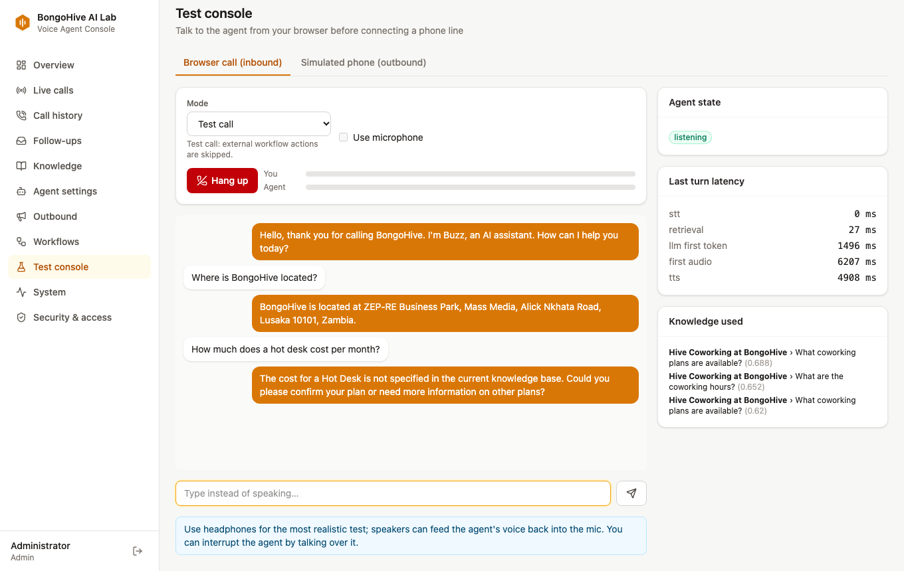
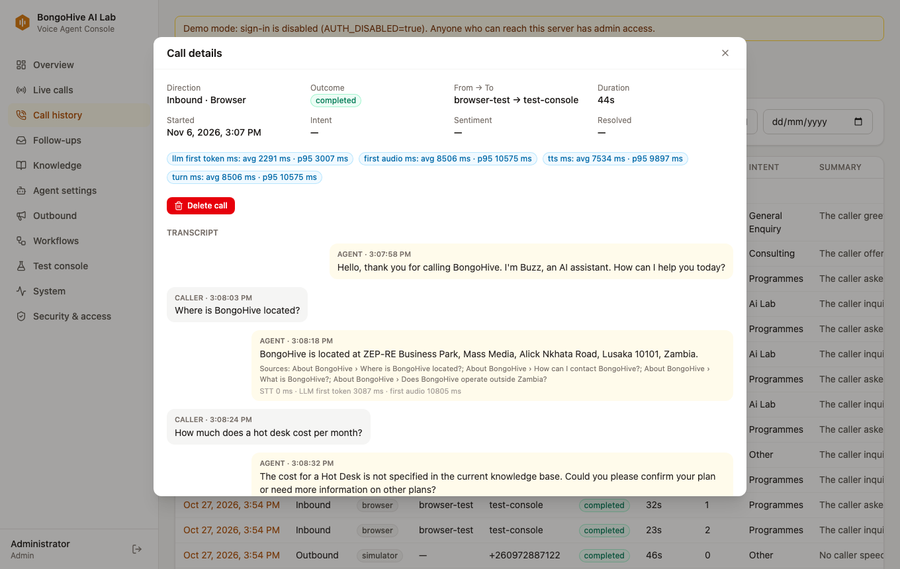
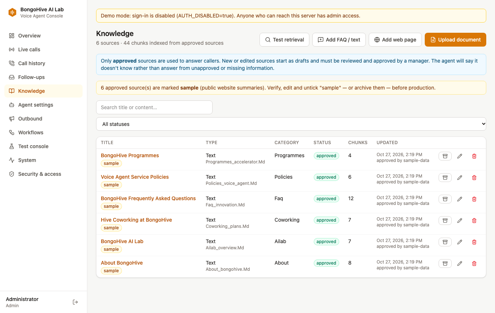
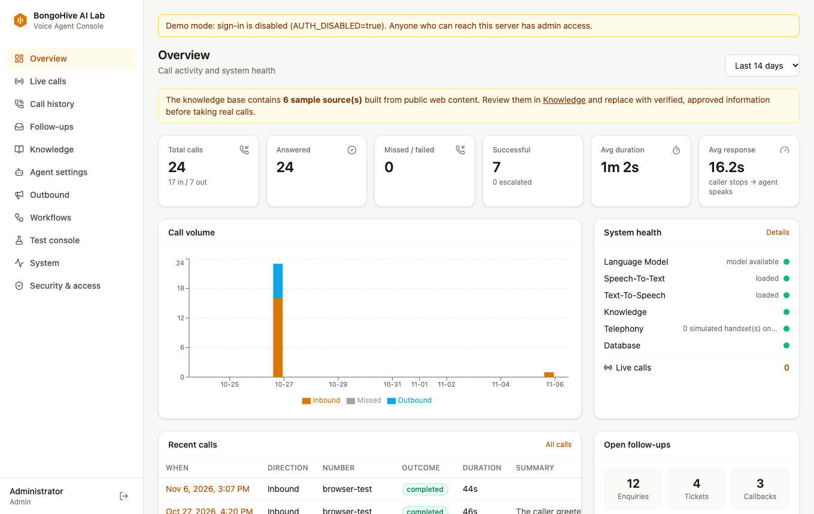
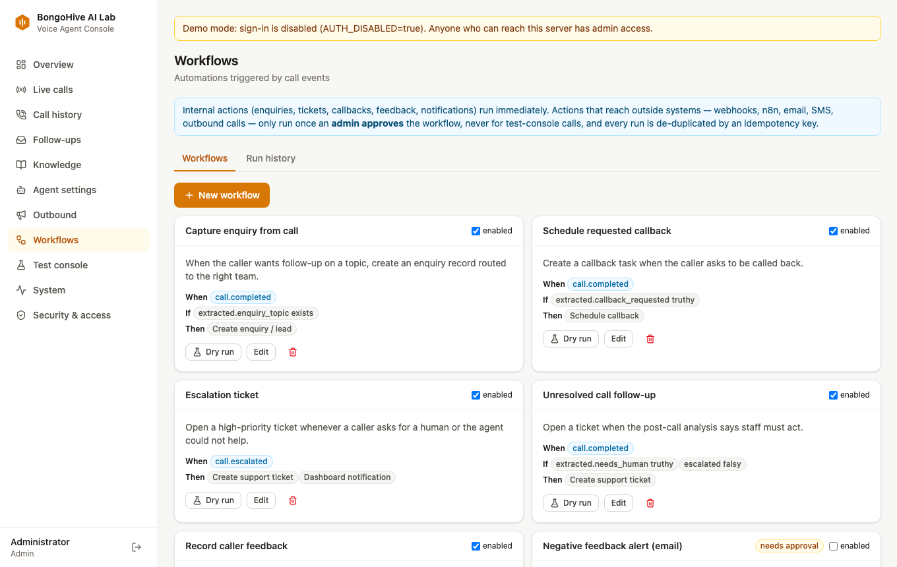
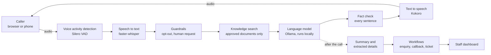

# Buzz: BongoHive AI Voice Agent

Buzz is a self-hosted AI voice agent built for the BongoHive AI Lab in Lusaka. It holds a real spoken conversation, answers only from knowledge that staff have approved, says so when it doesn't know, and turns each conversation into follow-up work for the team. Staff run everything from a web dashboard, without touching code.

It runs on free, open-source components, so conversations can stay on BongoHive's own server, and it works **today in a web browser, with no phone line, SIP trunk or Twilio account**. Connecting a real +260 number is an optional later step.



## Contents

- [What it does](#what-it-does)
- [How a conversation works](#how-a-conversation-works)
- [Current status](#current-status)
- [Run it on your computer](#run-it-on-your-computer)
- [A five-minute tour](#a-five-minute-tour)
- [Using it without a phone line](#using-it-without-a-phone-line)
- [Configuration](#configuration)
- [Testing](#testing)
- [Deploying it](#deploying-it)
- [Project layout](#project-layout)
- [Documentation](#documentation)

## What it does

| Area | What you get |
|---|---|
| **Natural conversation** | Streaming speech recognition, spoken replies that start before the full answer is written, interruption handling (talk over the agent and it stops), silence prompts and a polite hang-up |
| **Grounded answers** | Answers come from approved documents (PDF, Word, PowerPoint, HTML, Markdown, CSV FAQs, approved web pages). A relevance threshold and a fact-checker stop it inventing prices, numbers or contact details |
| **Honest by design** | Says it is an AI on every call, even if the caller interrupts the greeting. Admits when it doesn't know and offers a human follow-up |
| **Follow-up work** | After each conversation it writes a summary, extracts the caller's details and intent, and creates enquiries, callbacks and tickets for the right team |
| **Workflows** | A rule engine with nine templates: enquiries, tickets, callbacks, feedback, notifications, webhooks, n8n, email and SMS. Anything that reaches an outside system needs admin approval |
| **Safe outbound calling** | Consent per contact, instant opt-out, approved campaigns, calling windows, hourly caps and a kill switch. Off by default |
| **Staff dashboard** | Overview, live monitor, searchable call history, follow-ups, knowledge management, agent settings with voice preview, workflows, browser test console, system health, users and audit log |
| **Security and privacy** | Role-based access (viewer, operator, manager, admin), Argon2 passwords with lockout, scoped API keys, rate limiting, audit trail, retention rules and data-subject erasure |

| Call record with transcript and sources | Knowledge base with an approval flow |
|---|---|
|  |  |

| Overview | Workflows |
|---|---|
|  |  |

## How a conversation works



1. **Listen.** The audio stream is watched for speech, and the end of each sentence is detected automatically.
2. **Understand.** Whisper turns the speech into text. Requests to stop calling or to reach a human are handled by fixed rules, not left to the AI.
3. **Look it up.** The question is matched against approved knowledge only. If nothing relevant is found, the agent is told to say it doesn't know.
4. **Answer.** The local language model writes a short reply. Each sentence is checked before it is spoken: an amount, phone number, email or link that isn't in the knowledge base is replaced with an honest fallback.
5. **Speak.** Kokoro speaks each sentence as soon as it is ready, so the caller isn't waiting for the whole reply. If the caller talks over it, it stops.
6. **Follow up.** When the call ends, a summary and structured details feed the workflow engine, and staff see the result in the dashboard.

**Built with:** Python, FastAPI, SQLAlchemy, React, TypeScript, Vite, Tailwind, faster-whisper, Kokoro-82M, Ollama, ONNX Runtime, SQLite or PostgreSQL, Docker, and Asterisk for phone lines.

The design and the technology comparison are in [ARCHITECTURE.md](docs/ARCHITECTURE.md).

## Current status

| Part | Status |
|---|---|
| Voice pipeline, dashboard, knowledge, workflows, simulated phone network | **Working.** 86 automated backend tests, plus a browser test of all 11 dashboard pages and an inbound and outbound call |
| Real phone calls (Asterisk and a SIP trunk) | **Written but not tested on a live line.** No trunk was available; see [TELEPHONY_ZAMBIA.md](docs/TELEPHONY_ZAMBIA.md) |
| Knowledge content | **Sample only.** Summarised from the public bongohive.co.zm website and flagged as sample in the dashboard. Staff must verify it and replace it before real use |
| Email, SMS and n8n delivery | **Written, needs credentials.** Tested against stubs only |
| Languages | **English only.** Bemba, Nyanja and other local languages are not supported yet; see [VOICE_EVALUATION.md](docs/VOICE_EVALUATION.md) |
| Compliance | **Needs legal sign-off** before real calls; see [COMPLIANCE.md](docs/COMPLIANCE.md) |

Speed depends heavily on hardware. On a CPU-only laptop, replies took from about 1.5 seconds on an idle machine to well over 10 seconds under load. See [PERFORMANCE.md](docs/PERFORMANCE.md) and the full picture in [STATUS.md](docs/STATUS.md).

## Run it on your computer

**You need:** Python 3.12, Node 20 or newer, [Ollama](https://ollama.com), Google Chrome for the browser tests, and about 5 GB of free disk space. 16 GB of RAM is recommended.

```bash
# 1. Get the code
git clone https://github.com/WazDevZm/new-buzz.git
cd new-buzz

# 2. Backend
python3.12 -m venv .venv
source .venv/bin/activate
pip install -r backend/requirements-dev.txt

# 3. AI models (about 2 GB, downloaded once; they are not stored in this repo)
python scripts/download_models.py
ollama pull qwen2.5:3b-instruct

# 4. Dashboard
cd frontend && npm ci && npm run build && cd ..

# 5. Settings
cp .env.example .env

# 6. Start the language model, then the demo (use two terminals)
ollama serve
./scripts/run_demo.sh
```

Open **http://localhost:8080**. The first start takes a minute or two while it loads the models and indexes the sample knowledge.

`scripts/run_demo.sh` is for local demos only. It listens on your own machine, uses a separate database in `data/demo`, simulates the phone network, and **turns sign-in off**. A yellow banner reminds you of this. Never expose it to the internet.

To run with sign-in instead, set `ADMIN_EMAIL` and `ADMIN_PASSWORD` in `.env`, then run `cd backend && uvicorn app.main:app --port 8000`. You will be asked to change the password on first login.

## A five-minute tour

1. **Test console → Start call.** Talk to Buzz using your microphone, or untick **Use microphone** and type. Use headphones: through speakers, the microphone hears the agent and treats it as an interruption.
2. **Ask something it knows:** "Where is BongoHive located?" The side panel shows the knowledge it used.
3. **Ask something it can't know:** "Who is the CEO?" It says it doesn't have that information, and it won't guess.
4. **Leave your details:** "My name is Mwila, my number is 0971234567, please call me back tomorrow morning." Then hang up.
5. **Call history and Follow-ups.** The transcript, summary and the callback task are there, with no manual entry.
6. **Knowledge.** Upload a document and approve it, then ask about it in a new call.
7. **Agent settings.** Change the greeting or the voice and play a preview.

To watch an automated call run itself in a Chrome window:

```bash
node scripts/browser_call_demo.mjs
```

For a phone-style outbound call, open **Test console → Simulated phone**, click **Go online**, add that number as a consented contact, then use **Outbound → Single call**.

## Using it without a phone line

The browser is a full voice channel, so a phone line isn't needed to get value from this. It can serve as a front-desk assistant, an event information desk, an intake interviewer for AI assessments, a post-event feedback collector, a staff knowledge assistant, and a live demo for AI Lab clients.

[docs/USE_CASES.md](docs/USE_CASES.md) covers each idea, and says what works today and what needs a small build.

## Configuration

All settings live in `.env`, and [.env.example](.env.example) explains each one. The ones you are most likely to change:

| Setting | Purpose |
|---|---|
| `LLM_MODEL` | The language model. Use a bigger one on better hardware |
| `LLM_PROVIDER`, `LLM_BASE_URL`, `LLM_API_KEY` | Use any OpenAI-compatible hosted API instead of Ollama. Conversations then leave your server |
| `STT_MODEL` | `base.en` is fast, `small.en` is more accurate |
| `TTS_KOKORO_MODEL` | Use `kokoro/kokoro-v1.0.int8.onnx` on small CPUs |
| `MAX_CONCURRENT_CALLS` | Size this to your hardware |
| `TELEPHONY_PROVIDER` | `simulator` (no phone line) or `asterisk` |
| `OUTBOUND_ENABLED` | Off by default. Turn on only after the compliance checklist |
| `AUTH_DISABLED` | Local demos only. The server refuses to start with it in production |

### Choosing a model

| Hardware | `LLM_MODEL` | `STT_MODEL` | TTS |
|---|---|---|---|
| CPU or Apple Silicon, 16 GB | `llama3.2:3b` or `qwen2.5:3b-instruct`* | `small.en` | `kokoro-v1.0.int8.onnx` |
| NVIDIA GPU, 12 to 16 GB | `qwen2.5:7b-instruct` | `large-v3-turbo` | `kokoro-v1.0.onnx` (GPU) |

\* The Qwen2.5 **3B** weights are under the Qwen Research licence, so they suit evaluation. For commercial production use a model with a suitable licence, such as `qwen2.5:7b-instruct`. See [COSTS.md](docs/COSTS.md).

## Testing

```bash
cd backend && python -m pytest -q             # unit, API and call-engine tests, no AI models needed for most
node scripts/browser_smoke_test.mjs           # every page, plus an inbound and outbound call in real Chrome
python scripts/e2e_call.py --password '...'   # a full voice call with recorded audio over a websocket
cd backend && python ../scripts/eval_answers.py   # answer accuracy and hallucination check with the real model
cd backend && python ../scripts/benchmark.py      # speech accuracy, voice speed, model latency
python scripts/loadtest.py --calls 4          # concurrent calls
```

The browser test needs a running demo server. Add `--headed` to watch it.

## Deploying it

[DEPLOYMENT.md](docs/DEPLOYMENT.md) covers Docker Compose (app, PostgreSQL and Ollama, with optional Asterisk and n8n), HTTPS, GPUs, backups and migrations.

Before anything goes online:

- Use `ENVIRONMENT=production`. The app then refuses to start with weak settings or with sign-in disabled.
- Serve it over HTTPS, because browsers only allow the microphone on secure pages.
- Replace the sample knowledge with verified content.

## Project layout

```text
backend/app/
  voice/        call session, voice detection, speech to text, text to speech, recorder
  agent/        conversation and prompts, guardrails, fact check, post-call summary
  knowledge/    document extraction, chunking, embeddings, search index
  telephony/    provider interface, simulator, Asterisk (AudioSocket and AMI), number rules
  outbound/     dialer, compliance checks, retries
  workflows/    engine, actions, templates
  services/     events, settings, calls, retention and start-up tasks
  api/          REST and websocket routes
backend/tests/  pytest suite
backend/alembic/  database migrations
frontend/       React dashboard
telephony/asterisk/  Asterisk image and config templates
sample_data/    sample knowledge and recorded caller audio
scripts/        demo launcher, model download, browser tests, evaluation, benchmarks
docs/           guides and screenshots
```

AI models and runtime data are not stored in this repository. `scripts/download_models.py` fetches the models, and databases, recordings and uploads stay in the local `data/` folder.

## Documentation

| Document | Contents |
|---|---|
| [USE_CASES.md](docs/USE_CASES.md) | Ways to use Buzz at BongoHive without a phone line |
| [ARCHITECTURE.md](docs/ARCHITECTURE.md) | Components, call flow, technology evaluation, security, scaling |
| [STATUS.md](docs/STATUS.md) | Completed features, test results, blockers, next steps |
| [DEPLOYMENT.md](docs/DEPLOYMENT.md) | Docker, HTTPS, GPU, backups, migrations |
| [TELEPHONY_ZAMBIA.md](docs/TELEPHONY_ZAMBIA.md) | Providers, SIP setup, acceptance tests |
| [COMPLIANCE.md](docs/COMPLIANCE.md) | Zambian data protection and calling obligations |
| [VOICE_EVALUATION.md](docs/VOICE_EVALUATION.md) | Voice comparison, Zambian English, local languages |
| [PERFORMANCE.md](docs/PERFORMANCE.md) | Measured latency, accuracy and resource use |
| [COSTS.md](docs/COSTS.md) | Free and paid components, hardware tiers, cost per call |
| [API.md](docs/API.md) | REST, websockets, webhooks, n8n recipe |
| [TROUBLESHOOTING.md](docs/TROUBLESHOOTING.md) | Common problems and fixes |
